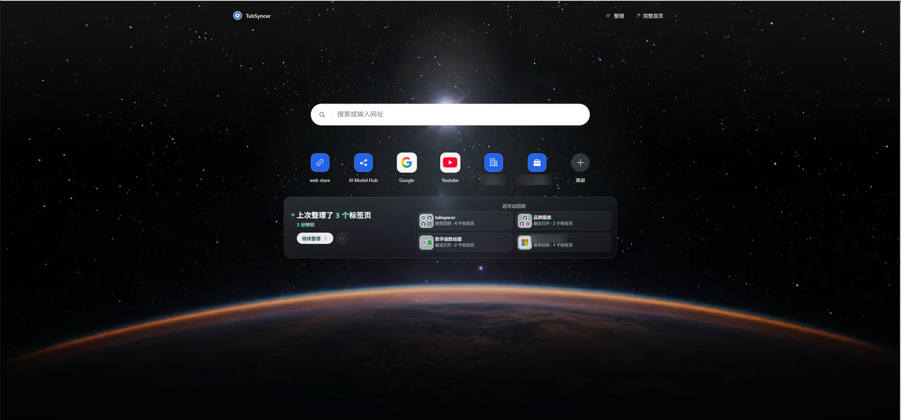
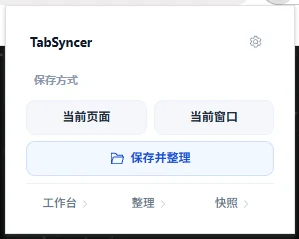
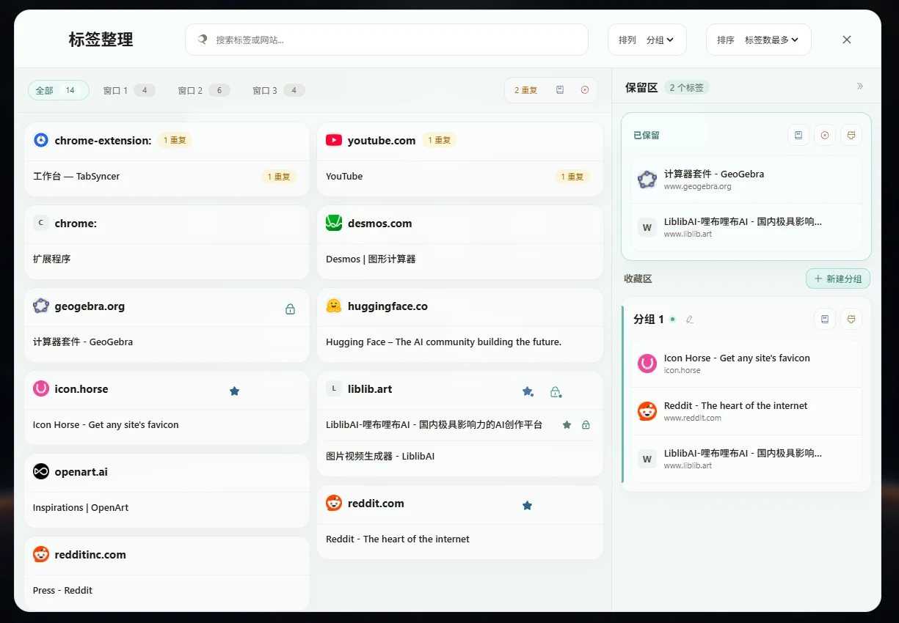
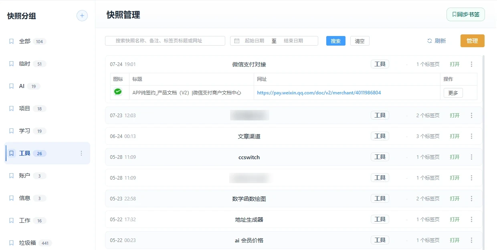

# TabSyncer

[中文版](README.md) | [English](doc/README.en.md)

**标签页太多？先收起来，以后接着看。**

TabSyncer 是一款浏览器标签页管理工具。你可以把打开的网页保存为快照，需要时再找到并打开；也可以按主题整理网页，在新标签页快速访问常用内容。

新标签页工作台集中提供搜索、快捷入口和快照推荐，方便继续整理或回到常用网页。

## 可以用来做什么？

- **收起暂时不用的网页**：保存当前页面或当前窗口中的网页，之后重新打开。
- **整理项目和学习资料**：将相关网页保存在一起，通过分组和搜索找到它们。
- **在不同设备查看收藏**：登录同一个账号，查看和打开已保存的快照。

## 主要功能

### 收藏与重新打开

点击浏览器工具栏中的 TabSyncer 图标，可以保存当前页面或当前窗口中的网页。需要时，可以打开整组网页，也可以只打开其中一个。

选择「保存并整理」，可以保存当前窗口的网页并收起可关闭的标签页；浏览器中固定的标签页会保留。收起标签页有助于减少浏览器内存占用，实际效果取决于页面和浏览器状态。

**什么是快照？** 快照是一组保存下来的网页，可以只有一个，也可以包含多个。它保存网页链接，尚未提交的表单等页面内容不一定能恢复。

### 整理打开的标签

在标签整理界面查看打开的网页，保留还要使用的标签、关闭不需要的标签，也可以将网页加入收藏区并保存。重复打开的网页会有标记，方便整理。

### 首页：管理收藏的网页

在首页查看收藏的快照，按分组或关键词查找需要的网页；可以展开快照查看其中的标签页，选择单独打开或整组打开。

还可以合并快照、清理重复网页，或从垃圾箱恢复误删的快照。

### 关联图谱：发现相关内容

使用关联图谱查看可能相关的快照，发现共同网页和相似资料。

其他功能包括导入 Chrome 书签、导出快照到本地和多语言界面。

## 安装与开始使用

### 从 Chrome 应用商店安装

推荐从 [Chrome 应用商店安装 TabSyncer](https://chromewebstore.google.com/detail/tabsyncer/ngfhokcebemclkfagnkgfficddkmcoim)。安装后，可以在浏览器的扩展程序菜单中将它固定到工具栏。

### 手动安装发布包

1. 从[发布页面](https://github.com/cso1z/TabSyncerForPublic/releases)或本仓库下载 `TabSyncer.zip`，并解压。
2. 在 Chrome 中打开 `chrome://extensions/`，开启「开发者模式」。
3. 点击「加载已解压的扩展程序」，选择解压后的目录。

手动安装后需要自行更新。[查看使用指南](https://www.joker.blue/tab/website/guide)，了解保存、整理和账号设置等操作。

也可以通过 [Web 版](https://www.joker.blue/tab/main)查看和管理已保存的快照。

## 账号与数据

- 可以先试用，不必一开始就填写邮箱。试用会创建临时账号；退出或更换设备前，建议绑定邮箱，或设置密码并保存账号 ID。
- 登录同一个账号后，可以在其他设备查看和打开该账号下的快照。
- 快照中的标题、网址和分组等信息保存在服务器，并与账号关联。详情请查看[隐私政策](https://www.joker.blue/tab/privacy-policy)。

## 反馈与版本

有问题或建议，欢迎在 [Issues](https://github.com/cso1z/TabSyncerForPublic/issues) 中交流。版本更新记录见[版本说明](doc/VERSION.zh.md)。

也欢迎加入 TabSyncer QQ 交流群，分享使用体验和建议。

