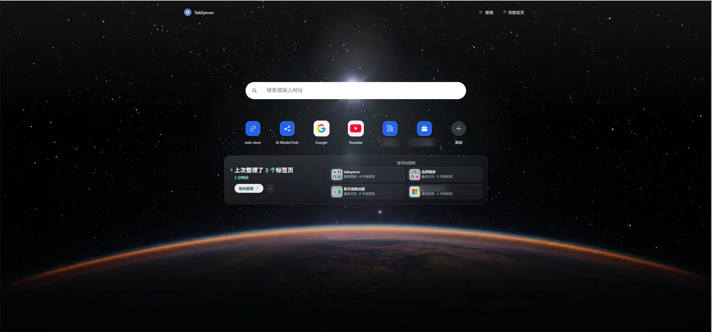
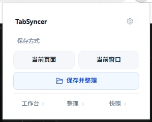
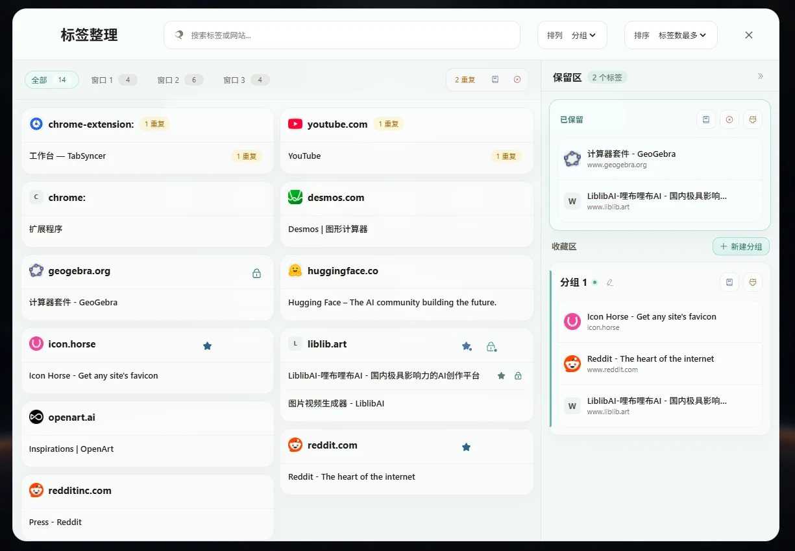
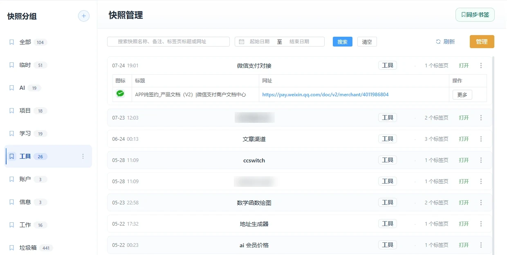

# TabSyncer

[中文版](../README.md) | [English](README.en.md)

**Too many open tabs? Save them for later.**

TabSyncer helps you organize and save browser pages as snapshots, then find and reopen them when you need them. Group related pages by topic and keep frequent links within reach on your new tab page.

The new tab workspace brings together search, shortcuts, and snapshot recommendations, so you can continue organizing or return to frequently used pages.

## What can you use it for?

- **Set pages aside**: Save the current page or the pages in the current window and reopen them later.
- **Organize project and study resources**: Keep related pages together and find them with groups and search.
- **Access saved pages on another device**: Sign in to the same account to view and open your snapshots.

## Features

### Save and reopen pages

Click the TabSyncer icon in the browser toolbar to save the current page or the pages in the current window. Later, reopen the whole set or just one page.

Choose “Save and organize” to save the current window's pages and close eligible tabs; pinned browser tabs stay open. Closing tabs can help reduce browser memory use, depending on the pages and browser state.

**What is a snapshot?** A snapshot is a saved collection of one or more pages. It saves links; page contents such as unsubmitted form data may not be restored when reopened.

### Organize open tabs

View open pages in the tab organizer, keep tabs you still need, close unwanted tabs, or add pages to a collection and save them. Duplicate pages are marked to make them easier to organize.

### Home: manage saved pages

View your snapshots on the home page and find saved pages by group or keyword. Expand a snapshot to see its tabs, then open a single page or the whole set.

You can also merge snapshots, remove duplicates, or restore deleted snapshots from the recycle bin.

### Relationship graph: discover related content

Use the relationship graph to find potentially related snapshots, shared pages, and similar resources.

Other features include Chrome bookmark import, local snapshot export, and a multilingual interface.

## Install and get started

### Install from the Chrome Web Store

The recommended option is to [install TabSyncer from the Chrome Web Store](https://chromewebstore.google.com/detail/tabsyncer/ngfhokcebemclkfagnkgfficddkmcoim). After installing, you can pin it to the toolbar from the browser's extensions menu.

### Install the release package manually

1. Download and extract `TabSyncer.zip` from the [releases page](https://github.com/cso1z/TabSyncerForPublic/releases) or this repository.
2. Open `chrome://extensions/` in Chrome and enable Developer mode.
3. Click “Load unpacked” and select the extracted directory.

Manual installations need to be updated manually. See the [user guide (Chinese)](https://www.joker.blue/tab/website/guide) for saving and organizing pages and setting up an account.

You can also use the [web app](https://www.joker.blue/tab/main) to view and manage saved snapshots.

## Account and data

- You can try TabSyncer without entering an email address first. A trial creates a temporary account; before signing out or changing devices, bind an email address, or set a password and save your account ID.
- Sign in to the same account on another device to view and open its snapshots.
- Snapshot information, including page titles, URLs, and groups, is stored on the server and associated with your account. See the [privacy policy](https://www.joker.blue/tab/privacy-policy) for details.

## Feedback and versions

Questions or suggestions? Join the discussion in [Issues](https://github.com/cso1z/TabSyncerForPublic/issues). See [version notes](VERSION.md) for release history.

You are also welcome to join the TabSyncer QQ group to share feedback and usage tips.

